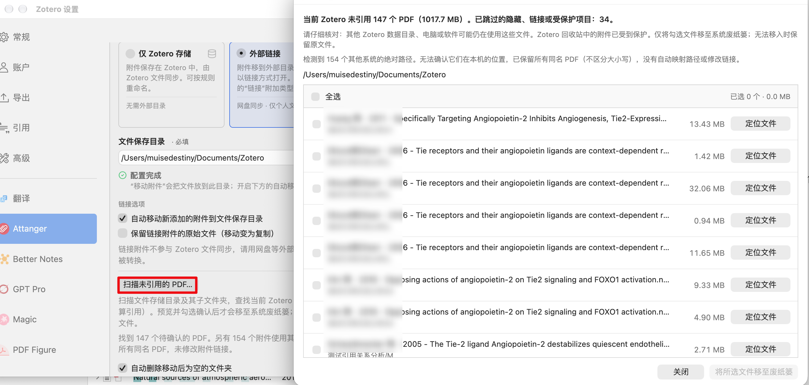

## 中文

### 新增：扫描未引用的 PDF

- 在设置的“外部链接”模式下新增“扫描未引用的 PDF”按钮，扫描文件保存目录及子目录，预览当前 Zotero 未引用的 PDF。
- 使用 Zotero 原生独立窗口：固定说明与底部操作区，仅文件列表滚动；支持全选、已选数量和容量统计、定位文件及完整路径提示。
- 默认不勾选文件。只有手动选择并再次确认后，才会将所选文件移至系统废纸篓；不会永久删除，也不会删除 Zotero 条目。

### 安全保护

- 检查当前 Zotero 的所有文库，回收站中的附件也算引用；跳过隐藏文件、符号链接和 Zotero 存储目录，并在清理前重新核对附件引用及文件状态。
- 兼容文库中其他操作系统的绝对路径，例如 macOS 上同步过来的 Windows 附件链接。无法确认本机位置时，保守保留目标目录中所有同名 PDF（不区分大小写），不自动映射路径或修改链接。
- **“未引用”仅指当前 Zotero 数据目录。其他电脑、Zotero 数据目录或软件仍可能使用这些文件，请核对后再清理。**

### 改进

- 优化批量附件匹配的重复检查：一次遍历已有附件，先按大小筛选再校验内容，减少无关 PDF 的重复读取。
- 添加扫描、校验、读取和导入进度提示，避免重复启动同一匹配任务；无法校验的文件会保留并计入结果。
- 更新设置页中的插件网站链接。

### 验证

- 全部 392 项自动化测试通过，TypeScript 类型检查、ESLint 和构建通过。
- 本版本不自动随 Zotero 条目删除外部 PDF；清理始终需要手动预览和确认。

### 界面预览

---

## English

### New: Scan For Unreferenced PDFs

- Added a scan button in the External Links settings to review PDFs in the configured destination directory and its subdirectories that are not referenced by the current Zotero data directory.
- Added a native Zotero preview window with a scrollable file list, fixed header and footer, select-all control, selection count and size, file reveal buttons, and full-path tooltips.
- Files are unchecked by default. Only explicitly selected and confirmed files are moved to the system Trash; there is no permanent-delete fallback and Zotero items are not deleted.

### Safety

- References in all libraries, including Zotero's trash, are protected. Hidden files, symbolic links, and Zotero storage directories are excluded. References and file state are checked again before recycling.
- Absolute attachment paths from other operating systems no longer prevent scanning. If their local location cannot be verified, all same-named PDFs in the destination are conservatively retained, case-insensitively. Links are never rewritten or automatically mapped.
- **Unreferenced means unreferenced by this Zotero data directory only. Other computers, Zotero data directories, or applications may still need these files. Review carefully before cleanup.**

### Improvements

- Improved batch duplicate checks by scanning existing attachments once, filtering by size before verifying content, and avoiding repeated reads of unrelated PDFs.
- Added scanning, verification, reading, and import progress; duplicate task starts are prevented. Unverified files are retained and reported.
- Updated the plugins website link in preferences.

### Verification

- All 392 automated tests pass, along with TypeScript checks, ESLint, and the build.
- Deleting a Zotero item does not automatically delete its external PDF. Cleanup remains a manual preview-and-confirm operation.
