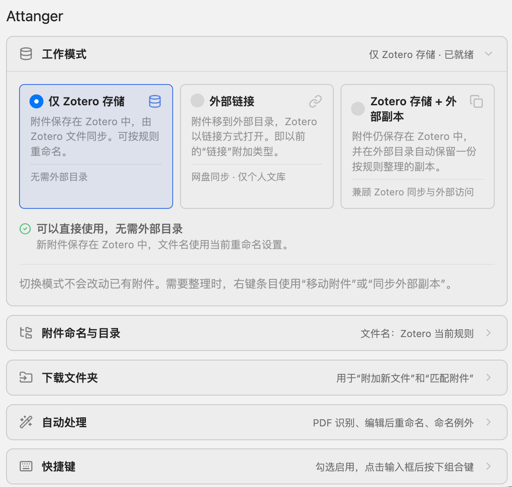
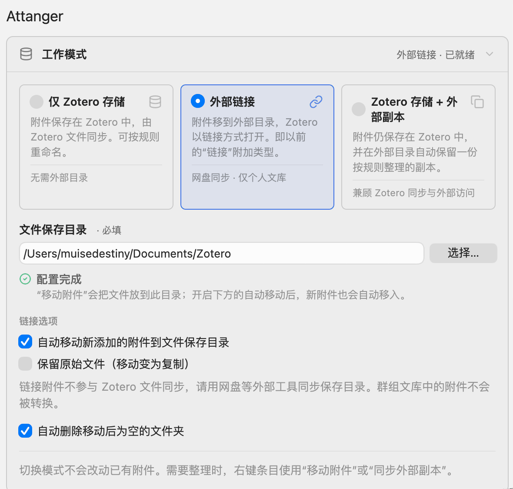
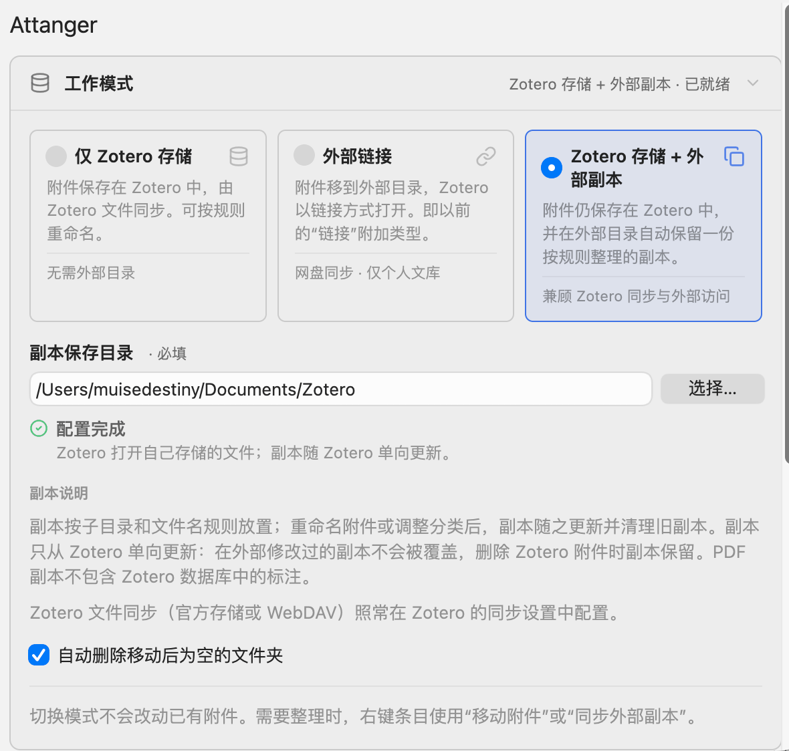
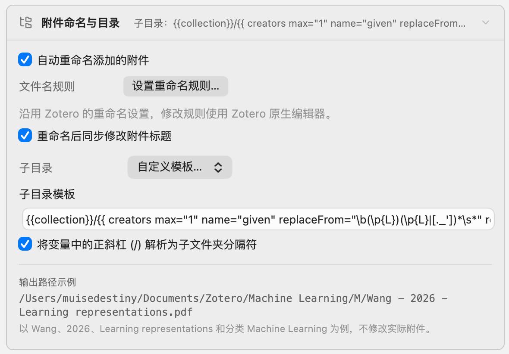
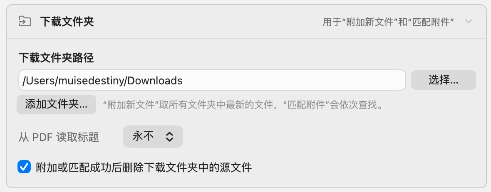
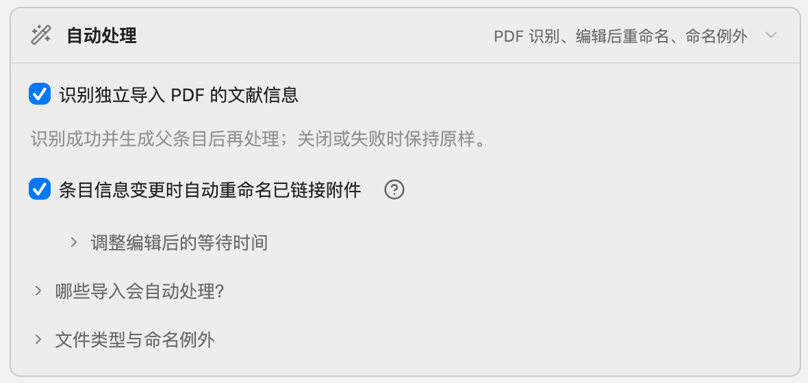

# Zotero Attanger

<p>
  
</p>

Attanger (Attachment Manager) organizes Zotero attachments: attach recent
downloads, match files to items, rename them with Zotero's native templates,
and move or copy them into a predictable folder structure.

English | [简体中文](doc/README-zhCN.md) | [Deutsch](doc/README-de.md) | [Italiano](doc/README-itIT.md)

[](https://github.com/MuiseDestiny/zotero-attanger/releases)
[](https://github.com/MuiseDestiny/zotero-attanger/releases)
[](https://github.com/MuiseDestiny/zotero-attanger/releases)
[](LICENSE)
[](https://www.zotero.org/)

## Features

- **Three work modes**: keep attachments in Zotero storage, move them to your
  own folder as linked files, or keep them in Zotero and maintain an organized
  copy in an external folder.
- **Native renaming**: rename attachments with Zotero's filename format, with
  optional title sync, diacritics removal, and regex-based exceptions.
- **Folder layouts**: build subfolders from collections, years, or any Zotero
  template variable; a `/` in a value can create nested folders.
- **Download folders**: attach the newest download to an item or collection,
  or match a batch of PDFs to the selected items by title.
- **Automatic processing**: attachments added through Attanger, drag and drop,
  or the Zotero Connector are renamed and organized for the current mode.
- **Rename after edits**: keep linked filenames in sync when the title,
  authors, year, or Better BibTeX citation key changes.
- **Safe file handling**: moving a stored attachment keeps its annotations,
  notes, tags, relations, and full-text index, and existing files are never
  overwritten.
- **Extras**: open attachments with another app, and run the main commands
  with configurable shortcuts.

## Install

1. Download the latest `.xpi` from the
   [Releases page](https://github.com/MuiseDestiny/zotero-attanger/releases).
2. In Zotero, open **Tools > Plugins** (**Tools > Add-ons** in older versions).
3. Click the gear icon, choose **Install Plugin From File...**, and select the
   downloaded `.xpi`.
4. Restart Zotero if prompted.

Attanger supports Zotero 7 through 10.

## Quick Start

### Choose a Work Mode

|                    | Zotero Storage Only     | External Links                   | Zotero Storage + External Copy |
| ------------------ | ----------------------- | -------------------------------- | ------------------------------ |
| Zotero opens       | the stored file         | the linked file                  | the stored file                |
| File sync          | Zotero Storage / WebDAV | your cloud drive or another tool | Zotero Storage / WebDAV        |
| External directory | not needed              | required; files live there       | required; holds one-way copies |
| Libraries          | all                     | editable personal library only   | all                            |

- **Zotero Storage Only**: you sync files with Zotero Storage or WebDAV and
  just want consistent filenames.
- **External Links**: you want the files in your own folder, synced by
  OneDrive, Dropbox, Nutstore, or a similar tool.
- **Zotero Storage + External Copy**: you want to keep Zotero file sync and
  also browse an organized folder outside Zotero.

### First Steps

1. Open Zotero **Settings** (**Edit > Settings** on Windows and Linux,
   **Zotero > Settings** on macOS) and select **Attanger**.
2. Under **Work Mode**, choose a mode. For the external modes, click
   **Choose...**, select a folder, and wait for **Setup complete**.
3. In **Attachment Names and Folders**, check the filename rules, the
   subfolder layout, and the path preview.
4. To use **Attach New File** or **Match Attachment**, add your download
   folder under **Download Folder**.
5. Try a few items before processing a large selection.
6. Switching modes does not change existing attachments. To organize them,
   select the items, right-click, and choose **Attanger > Move Attachment** or
   **Attanger > Sync External Copy**.

## Settings

The settings are grouped into collapsible sections, and each header shows a
short summary. Only **Work Mode** is open at first; searching Zotero's
settings opens all sections temporarily.

Screenshots show the Chinese UI with example settings; defaults are listed in
the [settings reference](#settings-reference).

### Work Mode

<p>
  
</p>

| Mode                               | Behavior                                                                                                 | Directory                  |
| ---------------------------------- | -------------------------------------------------------------------------------------------------------- | -------------------------- |
| **Zotero Storage Only**            | Attachments stay in Zotero and use Zotero file sync. Renaming rules still apply.                         | none                       |
| **External Links**                 | Attachments move to an external directory and open through links. This is the former "Link" attach type. | **File Storage Directory** |
| **Zotero Storage + External Copy** | Attachments stay in Zotero, and an organized copy is kept in an external directory.                      | **Copy Directory**         |

The directory must exist, be writable, and lie outside Zotero's storage
folder, also when reached through a symbolic link. The status below the field
reads **Setup complete** when everything is ready. Otherwise it tells you what
to fix: **Choose an external directory to finish setup** (nothing is moved or
copied until then), **Directory unavailable; choose it again**, **Choose a
directory outside Zotero storage**, or **Directory is not writable; choose
another**.

<p>
  
  
</p>

**Link Options** (External Links only):

- **Automatically move new attachments to the storage directory** (on by
  default): new stored attachments are renamed (if automatic renaming is on),
  moved into the directory, and converted to linked attachments.
- **Keep original files of linked attachments (move becomes copy)** (off by
  default): when a linked attachment is moved, its old file stays in place,
  and the menu commands say **Copy** instead of **Move**. It does not apply to
  stored attachments: they are always converted, and their stored file is
  removed together with the old item.
- Zotero does not sync linked files. Sync the directory with a cloud drive or
  another tool. Attachments in group libraries are never converted.

**About Copies** (External Copy only):

- Copies follow the subfolder and filename rules. When you rename an
  attachment or change its collections, the copy moves and the old one is
  cleaned up.
- Copies update one way, from Zotero. A copy edited outside Zotero is never
  overwritten, and deleting the attachment in Zotero keeps its copy.
- PDF copies do not contain annotations made in Zotero, because Zotero keeps
  them in its database.
- Zotero file sync (Zotero Storage or WebDAV) is configured as usual in
  Zotero's sync settings.

**Automatically delete empty folders after moving** (external modes, off by
default): after a file moves away, folders left empty are removed, ignoring
`.DS_Store` and `Thumbs.db`. This only happens below the external directory or
a download folder; those folders themselves and Zotero storage are never
removed.

### Attachment Names and Folders

<p>
  
</p>

- **Automatically rename added attachments**: the same switch as Zotero's own
  automatic renaming (`extensions.zotero.autoRenameFiles`), so it affects
  Zotero too.
- **Filename Rules > Customize Filename Format...**: opens Zotero's native
  editor. Attanger uses this format for every rename; see
  [Zotero's file renaming guide](https://www.zotero.org/support/file_renaming).
- **Sync attachment title after renaming** (off by default): sets the
  attachment title to the new filename, including the extension. Even when it
  is off, a title equal to the old filename, or the generic title "PDF", is
  updated.
- **Subfolder** (external modes): **By Zotero collection** (`{{collection}}`,
  the default), **By year** (`{{year}}`), **No subfolders**, or **Custom
  template...**, which shows **Subfolder Template** and **Parse forward slashes
  (/) in variables as subfolder delimiters** (on by default).
- **Output path example** (**Filename example** in Zotero Storage Only): a
  live preview for a sample item by Wang, 2026, "Learning representations", in
  the collection "Machine Learning". It never changes real attachments, and it
  tells you when the sample `paper-2026.pdf` would be excluded by your file
  types or naming exceptions.

How subfolder templates are rendered:

- Separate folder levels with a `/` between `}}` and `{{`, for example
  `{{collection}}/{{year}}`.
- `{{collection}}` must be a level of its own. It becomes the collection
  path, such as `Machine Learning/Transformers`. Manual commands prefer the
  collection selected in the left pane if the item belongs to it; otherwise
  the item's first collection is used. Items outside any collection get no
  collection folder.
- Every other level uses Zotero's filename template syntax for the parent
  item, for example `{{ year }}` or `{{ creators max="1" }}`. Characters that
  are not allowed in folder names are removed. A `/` inside a value creates a
  nested folder when the slash option is on and is removed otherwise.

### Download Folder

<p>
  
</p>

The download folders are used by **Attach New File**, **Match Attachment**,
and **Match Attanger Attachment**. Ordinary imports work without them.

- **Download folder paths**: **Choose...** sets the main folder, **Add
  Folder...** adds more, and **Remove** takes an extra folder off the list.
  Attach New File takes the newest file across all folders; the match commands
  search them in order.
- **Read title from PDF**: **Never**, **Except for CJK** (default), or
  **Always**. Decides whether Match Attachment compares item titles with the
  title read from each PDF or with its filename.
- **Delete the file from the download folder after attaching or matching it**
  (on by default): removes the source file after Attach New File or Match
  Attachment. Files are deleted only while **My Library** or one of its
  collections is selected. Match Attanger Attachment never deletes files.

### Automatic Processing

<p>
  
</p>

- **Recognize standalone imported PDFs** (on by default): a PDF imported
  without a parent item goes through Zotero's metadata recognition and is
  processed once a parent item exists. If the option is off or recognition
  fails, the PDF is left as is. This is separate from Zotero's own
  **Automatically retrieve metadata for PDFs and ebooks** setting.
- **Automatically rename linked attachments when items change** (off by
  default): Zotero renames files when they are added, so existing linked files
  can keep old names after the title, authors, year, or Better BibTeX
  citation key changes. This option renames them again. It covers existing,
  editable linked files of the configured types and respects the "not
  automatically moved, copied, or renamed" rule.
- **Adjust waiting time after edits** (shown while the option above is on):
  - **Rename-after-edit debounce (ms)** (on, 1000): one edit can trigger
    several notifications, so Attanger waits until edits stop. Use 1000 ms
    normally, 1500-3000 ms if renames repeat, or 300-500 ms for a faster
    response.
  - **Rename-after-edit delay (ms)** (off, 0): extra time after the debounce
    for values that update asynchronously, such as Better BibTeX keys. Start
    with 300-1000 ms, and use 1500-3000 ms if old values still appear.
- **Which imports are processed automatically?** New attachments from
  Attanger, drag and drop, or the Zotero Connector follow the current mode.
  Linked files you add directly are not converted. Standalone PDFs are
  processed only after recognition creates a parent item.

**File Types and Naming Exceptions**:

- **Types of Attachments for Renaming/Moving** (default
  `pdf,doc,docx,txt,rtf,djvu,epub`): comma-separated extensions,
  case-insensitive, with or without a leading dot; spaces after commas are
  ignored. Leave it empty to include
  all types. Other files are not renamed, moved, or copied.
- **Remove diacritics from filenames** (off by default): converts accented
  letters and ligatures in the final filename to plain letters, for example
  `Müller` to `Muller`. The extension is kept.
- Three lists of regular expressions, separated by commas, for example
  `SI\d+, .+_si`. They are tested against the current filename without its
  extension and are not anchored, so `SI\d+` also matches `CASI2`.

| When the filename matches...                             | Result                                                                                             |
| -------------------------------------------------------- | -------------------------------------------------------------------------------------------------- |
| "...retained as a prefix during renaming"                | The old name is kept in front: `SI1.pdf` becomes `SI1_Wang - 2026 - Learning representations.pdf`. |
| "...attachments will not be renamed"                     | No renaming, manual or automatic.                                                                  |
| "...will not be automatically moved, copied, or renamed" | Skipped by automatic processing and rename-after-edit; manual commands still work.                 |

Because commas separate the rules, a rule cannot contain a comma, so a
quantifier such as `{2,3}` is not possible. Invalid expressions are ignored
and written to the debug log.

### Keyboard Shortcuts

| Command                         | Default            | Enabled by default |
| ------------------------------- | ------------------ | ------------------ |
| Attach New File                 | `Ctrl + I`         | yes                |
| Match Attachment                | `Ctrl + M`         | yes                |
| Rename Attachment               | `Ctrl + R`         | no                 |
| Rename and Move/Sync Attachment | `Ctrl + Shift + R` | no                 |
| Move/Sync Attachment            | `Ctrl + Shift + M` | no                 |

Check a command to enable its shortcut, click the field, and press the key
combination. Changes apply immediately, and enabled shortcuts are shown next
to the menu commands. `Ctrl` means the Control key on every platform,
including macOS; a combination recorded with Cmd is saved as `Meta`. The
Move/Sync shortcuts follow the work mode; in Zotero Storage Only, **Move/Sync
Attachment** only shows a notice.

The **About** section links to the project on GitHub, the author's Bilibili
channel, and more plugins.

### Settings Reference

Preferences are stored under `extensions.zotero.zoteroattanger.` and can also
be inspected in **Settings > Advanced > Config Editor**.

| Setting                                     | Preference                                                                            | Default                                                   |
| ------------------------------------------- | ------------------------------------------------------------------------------------- | --------------------------------------------------------- |
| Work Mode                                   | `workMode`                                                                            | `stored` on a new install (`stored`, `linked`, or `copy`) |
| File Storage / Copy Directory               | `destDir`                                                                             | empty                                                     |
| Automatically move new attachments          | `autoMove`                                                                            | `true`                                                    |
| Keep original files                         | `moveWithoutDeleting`                                                                 | `false`                                                   |
| Automatically delete empty folders          | `autoRemoveEmptyFolder`                                                               | `false`                                                   |
| Automatically rename added attachments      | `extensions.zotero.autoRenameFiles` (Zotero)                                          | `true`                                                    |
| Sync attachment title after renaming        | `syncAttachmentTitle`                                                                 | `false`                                                   |
| Subfolder template                          | `subfolderFormat`                                                                     | `{{collection}}`                                          |
| Parse forward slashes as delimiters         | `slashAsSubfolderDelimiter`                                                           | `true`                                                    |
| Download folder                             | `sourceDir`                                                                           | empty                                                     |
| Additional download folders                 | `extraSourceDirs`                                                                     | `[]` (JSON array)                                         |
| Read title from PDF                         | `readPDFtitle`                                                                        | `nonCJK` (`never`, `nonCJK`, or `always`)                 |
| Delete the file from the download folder    | `deleteSourceAfterImport`                                                             | `true`                                                    |
| Recognize standalone imported PDFs          | `autoRecognizeImportedPDF`                                                            | `true`                                                    |
| Rename linked attachments when items change | `autoRenameOnModify`                                                                  | `false`                                                   |
| Rename-after-edit debounce                  | `autoRenameOnModifyDebounceEnabled`, `autoRenameOnModifyDebounceMs`                   | `true`, `1000`                                            |
| Rename-after-edit delay                     | `autoRenameOnModifyDelayEnabled`, `autoRenameOnModifyDelayMs`                         | `false`, `0`                                              |
| Types of attachments                        | `fileTypes`                                                                           | `pdf,doc,docx,txt,rtf,djvu,epub`                          |
| Remove diacritics                           | `removeDiacritics`                                                                    | `false`                                                   |
| Naming exceptions                           | `filenameAsPrefixRules`, `filenameSkipRenameRules`, `filenameSkipAutoMoveRenameRules` | empty                                                     |
| Shortcuts                                   | `<command>.shortcut`, `<command>.shortcut.enable`                                     | see [Keyboard Shortcuts](#keyboard-shortcuts)             |
| Open Using apps                             | `openUsing`                                                                           | empty list                                                |

`<command>` is `attachNewFile`, `matchAttachment`, `renameAttachment`,
`renameMoveAttachment`, or `moveAttachment`. The legacy `attachType`
preference follows the work mode (`linking` for External Links, `importing`
otherwise) so that older Attanger versions still work after a downgrade.

## Menu Commands

Right-click the selected items and open **Attanger**. Three entries depend on
the work mode:

| Entry                | Zotero Storage Only      | External Links                 | Zotero Storage + External Copy    |
| -------------------- | ------------------------ | ------------------------------ | --------------------------------- |
| Rename and Move/Sync | **Rename Attachment**    | **Rename and Move Attachment** | **Rename and Sync External Copy** |
| Move/Sync            | hidden                   | **Move Attachment**            | **Sync External Copy**            |
| Undo                 | **Undo Move Attachment** | **Undo Move Attachment**       | **Undo Move Attachment**          |

With **Keep original files** on, External Links shows **Rename and Copy
Attachment**, **Copy Attachment**, and **Undo Copy Attachment** instead.

- **Attach New File** (exactly one regular item selected): attaches the newest
  file from the download folders. Any file type is accepted; hidden files and
  subfolders are ignored. If no download folder exists, Attanger asks you to
  choose one.
- **Rename and Move Attachment**: moves each attachment, then renames it; if
  the move is skipped, nothing is renamed. **Rename and Sync External Copy**
  renames, then syncs the copy.
- **Match Attachment**: assigns PDF and CAJ files from the download folders to
  the selected items by title similarity. See
  [Match downloaded files](#match-downloaded-files).
- **Match Attanger Attachment**: finds files that already have the expected
  Attanger path and name. See
  [Reconnect an existing library](#reconnect-an-existing-library).
- **Rename Attachment**: renames the child attachments in the selection with
  Zotero's filename format. Standalone attachments are skipped.
- **Move Attachment** / **Sync External Copy**: moves files into the File
  Storage Directory, or creates and updates their external copies. Standalone
  attachments are included.
- **Undo Move Attachment**: runs Zotero's **Convert to Stored Files** on the
  selected linked attachments and on the linked attachments of selected items.
  Zotero asks whether to **Delete original files after storing**. The
  restored attachments stay in Zotero storage, even when automatic moving is
  on.

Two more commands are outside the Attanger submenu:

- **Open Using** (item menu, when the selection has attachments): opens the
  file with **Zotero**, **System** (the default app), a remembered app, or
  **Choose Other App**. Right-click a remembered app to remove it. For a
  regular item, the best attachment is opened. This works by switching
  Zotero's PDF handler, so it is meant for PDFs.
- **Attach New File** (collection menu): adds the newest download to that
  collection as a standalone attachment and starts metadata recognition.

## Common Workflows

### Attach the latest download

1. Save the PDF into a download folder.
2. Select its item and press `Ctrl + I` (or choose **Attanger > Attach New
   File**).
3. The file is attached, then renamed and moved or copied for the current
   mode. The downloaded file is deleted if that option is on.

To start a new item from the PDF instead, right-click a collection and choose
**Attach New File**.

### Match downloaded files

1. Put the PDFs in a download folder.
2. Select only the items whose files are there, and press `Ctrl + M`.
3. Each item receives the remaining file with the most similar title; every
   file is used once.

> **Caution:** there is no similarity threshold. While files remain, every
> selected item gets the closest one, even if it is a poor match.

Only `.pdf` and `.caj` files directly inside the download folders are
considered, and items with shorter titles are matched first. **Read title
from PDF** decides what is compared with each item title: the filename
(**Never**), the PDF title (**Always**), or the PDF title except for items
whose titles contain Chinese, Japanese, or Korean characters (**Except for
CJK**). The PDF title comes
from its metadata or, if that is missing, the largest text; reading gives up
after 30 seconds and falls back to the filename.

### Reconnect an existing library

Use this when your files are already organized in Attanger's layout, for
example after reinstalling Zotero or moving to a new computer.

1. Make sure the subfolder template and Zotero's filename format still
   produce the existing paths.
2. Add the root of that folder as a download folder.
3. Select the items and choose **Attanger > Match Attanger Attachment**.

For each extension in **Types of Attachments for Renaming/Moving**, Attanger
looks for `<download folder>/<subfolder>/<filename>.<ext>`, trying the
folders in order. A file is skipped if the item already has an attachment
titled with that filename. Source files are never deleted.

- In **Zotero Storage Only** and **External Links**, files are added as linked
  attachments where they are. This works only in My Library.
- In **Zotero Storage + External Copy**, files are imported into Zotero
  storage. If the download folder is the copy directory itself, the original
  file is adopted as the external copy, so no `name_1.ext` duplicate is
  written.

### Organize existing attachments after switching modes

- **To External Links**: select the items and run **Move Attachment**. Stored
  attachments become linked files in the File Storage Directory and keep
  their annotations, notes, tags, relations, and full-text index.
- **To External Copy**: select the items and run **Sync External Copy** once.
  After that, their copies are refreshed automatically.
- **Back to Zotero storage**: select the items and run **Undo Move
  Attachment**. The attachments become stored files and are not moved out
  again by automatic moving. Switch to **Zotero Storage Only** as well if new
  attachments should stay in Zotero too.

### Rename files after Better BibTeX updates

If your filename format uses the Better BibTeX citation key, the key may not
be ready yet when a file is added.

1. Turn on **Automatically rename linked attachments when items change**.
2. Keep the debounce at 1000 ms. If files still get the old key, enable the
   delay and start with 300-1000 ms.

This only renames linked files. For stored attachments, run **Rename
Attachment** after the key changes.

## How Automatic Processing Works

New attachments are collected for about a second and then processed one by
one:

1. Linked attachments that Attanger has just created itself, and attachments
   restored by **Undo Move Attachment**, are skipped.
2. A standalone imported PDF is recognized first if **Recognize standalone
   imported PDFs** is on. Without a parent item, processing stops.
3. Unsupported file types and files matching the "not automatically moved,
   copied, or renamed" rule are left alone.
4. If **Automatically rename added attachments** is on, the file is renamed.
   This includes linked files you add directly, which are renamed in place.
5. In **External Links** with automatic moving, stored attachments are
   renamed first, then moved and converted to linked attachments.
6. In **Zotero Storage + External Copy**, stored attachments are renamed and
   then copied to the copy directory.

Trashing or deleting an item cancels its pending processing. All file
operations run through a single queue.

**Moving (External Links)**

- Requires an editable personal library; otherwise Attanger reports "External
  links work only in an editable personal library."
- The target is `<File Storage Directory>/<subfolder>/<filename>`. The file
  is copied to a temporary file, verified by MD5, and published without
  overwriting anything: taken names get `_1`, `_2`, and so on. A file that is
  already at its target stays put.
- A linked attachment is relinked. Its old file is deleted unless **Keep
  original files** is on, another attachment uses it, it changed during the
  move, or it lies inside Zotero storage.
- A stored attachment is replaced by a new linked attachment. Annotations
  (including trashed ones), child notes, tags, relations, the attachment note,
  and the full-text index are transferred; then the stored item and its file
  are erased.

**Renaming**

- Requires a parent item. The new name is Zotero's filename format plus the
  original extension.
- The rules apply in this order: skip rule, prefix rule, diacritics removal.
- If the name is taken, Zotero's numbering is used (`name 2.pdf`).
- A linked file shared by several attachments is copied to the new name and
  relinked, so the other attachments keep their file.
- Failed renames, for example of a locked file, are retried up to five times,
  three seconds apart.

**External copies**

- Only stored attachments get copies; linked attachments are skipped with a
  notice.
- A copy is refreshed about a second after its attachment, file, or
  collections change. This only applies to attachments that already have a
  copy, so run **Sync External Copy** once for existing attachments.
- A missing copy is recreated. A copy that was edited outside Zotero, or that
  another attachment links to, is reported as a conflict and left untouched.
  Otherwise the copy is replaced atomically, with a backup and rollback.
- When the target path changes, a new copy is written, and the old copy is
  removed only if it is unchanged and unused. If a file with identical content
  already sits at the target and no attachment uses it, it is adopted as the
  copy; a different file there is kept, and the copy gets `name_1.ext`.
- Copy records are kept in `attanger-external-copies.json` in the Zotero data
  directory.

## Upgrading From Earlier Versions

On first start, Attanger converts the old settings once:

- The old **Attach Type: Link** with a destination path becomes **External
  Links**; everything else becomes **Zotero Storage Only**. **Zotero Storage +
  External Copy** is new, so choose it yourself if you want it.
- **Delete the file from the download folder after attaching or matching it**
  is set to the opposite of the old **Keep original files** option, so
  download folders behave as before.
- In External Links, automatic moving and **Keep original files** keep their
  old meaning.
- Shortcuts and existing attachments are not changed.

| Earlier setting                                                                     | Now                                                                                                                                                                                            |
| ----------------------------------------------------------------------------------- | ---------------------------------------------------------------------------------------------------------------------------------------------------------------------------------------------- |
| Attach Type: Stored Copy / Link                                                     | **Work Mode**                                                                                                                                                                                  |
| Source Path                                                                         | **Download Folder > Download folder paths**                                                                                                                                                    |
| Destination Path                                                                    | **File Storage Directory** (External Links) or **Copy Directory** (External Copy)                                                                                                              |
| Subfolder                                                                           | **Attachment Names and Folders > Subfolder**                                                                                                                                                   |
| Automatically move added attachments                                                | **Link Options > Automatically move new attachments to the storage directory**                                                                                                                 |
| Keep original files (never delete source files); move operations become copy        | **Keep original files of linked attachments (move becomes copy)** for moves, and the inverted **Delete the file from the download folder after attaching or matching it** for download folders |
| Automatically retrieve metadata for standalone imported PDFs before renaming/moving | **Recognize standalone imported PDFs**                                                                                                                                                         |
| read title from PDF file                                                            | **Download Folder > Read title from PDF**                                                                                                                                                      |
| Other Settings                                                                      | **Attachment Names and Folders**, **Automatic Processing**, and **Keyboard Shortcuts**                                                                                                         |
| Shortcut for Rename and Move/Copy Attachment, Shortcut for Move/Copy Attachment     | **Rename and Move/Sync Attachment**, **Move/Sync Attachment**                                                                                                                                  |

## Notes and Limitations

- Zotero does not sync linked files. Sync the File Storage Directory yourself,
  and consider setting **Settings > Advanced > Files and Folders > Linked
  Attachment Base Directory** to it so links also resolve on other computers.
- External Links works only in your editable personal library; attachments in
  group libraries are never moved. Outside External Copy mode, **Match
  Attanger Attachment** creates linked attachments, so it also needs My
  Library.
- Existing files are never overwritten: moves and copies add `_1`, `_2`, and
  so on, while renames use Zotero's numbering (`name 2.pdf`). External Copy
  reuses a file at the target only when its content is identical.
- Download-folder files are deleted only while **My Library** or one of its
  collections is selected.
- External PDF copies do not contain Zotero annotations; use Zotero's PDF
  export if you need them in the file.
- A naming-exception rule cannot contain a comma.
- `Ctrl` in shortcuts means the Control key on macOS too.
- **Match Attachment** assigns a file to every selected item while files
  remain, so select only items whose files are present.
- Linked files you add directly can be renamed in place but are never moved.
- Recent Zotero versions can rename files themselves when item metadata
  changes, including linked files if **Rename linked files** is enabled in
  Zotero's renaming settings. Use either that or Attanger's **Automatically
  rename linked attachments when items change**, not both.

## Screenshots and Guides

<p>
  
</p>

The item menu in External Links mode (Chinese UI).

- [Video demonstration (Chinese)](https://www.bilibili.com/video/BV1x64y1J7Rv)
- [Community guide (French)](https://docs.zotero-fr.org/kbfr/kbfr_attanger_zotmoov/)

## Contributing

Issues, fixes, new features, tests, documentation, and translations are all
welcome. Small, focused pull requests are easier to review and safer to ship.

When reporting a bug, include the Zotero and Attanger versions, your operating
system, the work mode, relevant settings, exact steps to reproduce, and debug
output (**Help > Debug Output Logging**). Remove private bibliographic data and
local paths before posting logs.

To work on the plugin:

```bash
git clone https://github.com/MuiseDestiny/zotero-attanger.git
cd zotero-attanger
npm install
cp scripts/zotero-cmd-template.json scripts/zotero-cmd.json
# Set zoteroBinPath and profilePath; use a dedicated Zotero test profile
npm start
```

`npm start` launches Zotero with the plugin and reloads it when files under
`src/` or `addon/` change.

Before opening a pull request:

```bash
npm run build                    # type check, then build/zotero-attanger.xpi
npm test
npx eslint src/modules/menu.ts   # lint the files you changed
```

`npm run lint` formats and fixes the whole repository, so prefer running
ESLint on the files you changed to keep the diff focused.

### AI-Assisted Contributions Are Welcome

You may use AI tools for implementation, debugging, tests, documentation, or
translation. AI use is not a reason to reject a contribution. The contributor
is still responsible for the submitted result:

- Review and understand generated changes before submitting them.
- Test the affected workflows and report what was actually verified.
- Keep changes scoped; do not include unrelated generated rewrites.
- Do not send private libraries, logs, credentials, or copyrighted documents
  to an AI service without permission.
- Confirm that generated code and assets are compatible with this project's
  license and dependency policies.
- Briefly disclose material AI assistance in the pull request when it helps
  reviewers understand how the change was produced or validated.

Translations live in `addon/locale/`; user documentation translations live in
`doc/`. Please keep keys and behavior descriptions aligned across languages.

## License and Credits

Zotero Attanger is licensed under
[AGPL-3.0-or-later](LICENSE). It draws significant inspiration from the ZotFile
attachment workflow and is built with the
[Zotero Plugin Template](https://github.com/windingwind/zotero-plugin-template)
and [zotero-plugin-toolkit](https://github.com/windingwind/zotero-plugin-toolkit).
