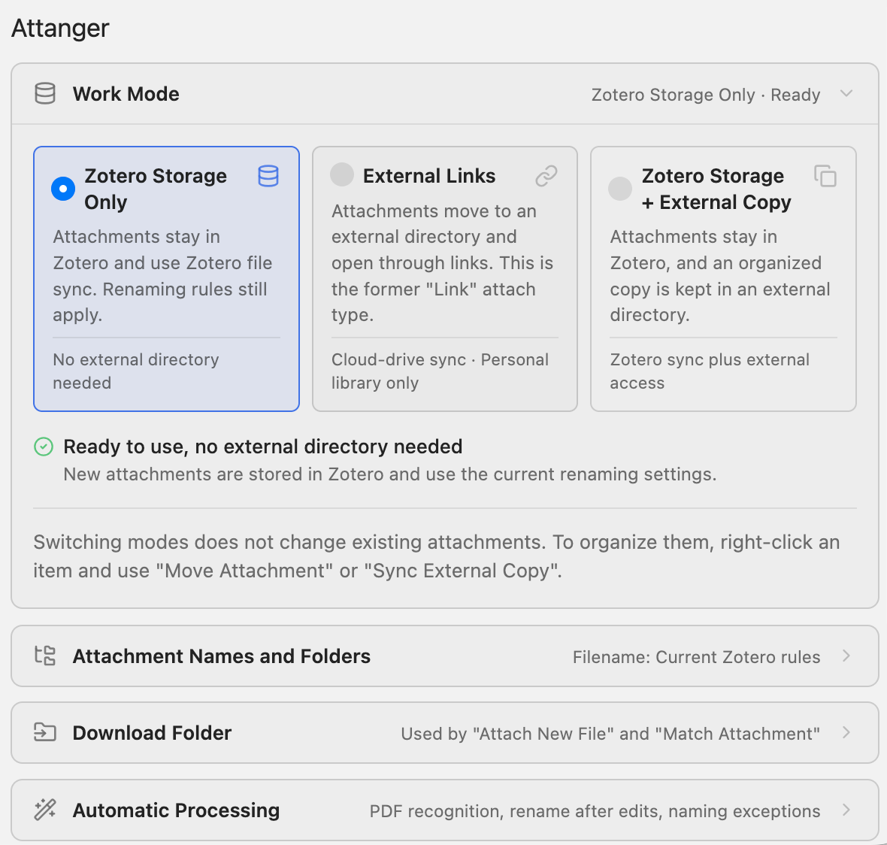
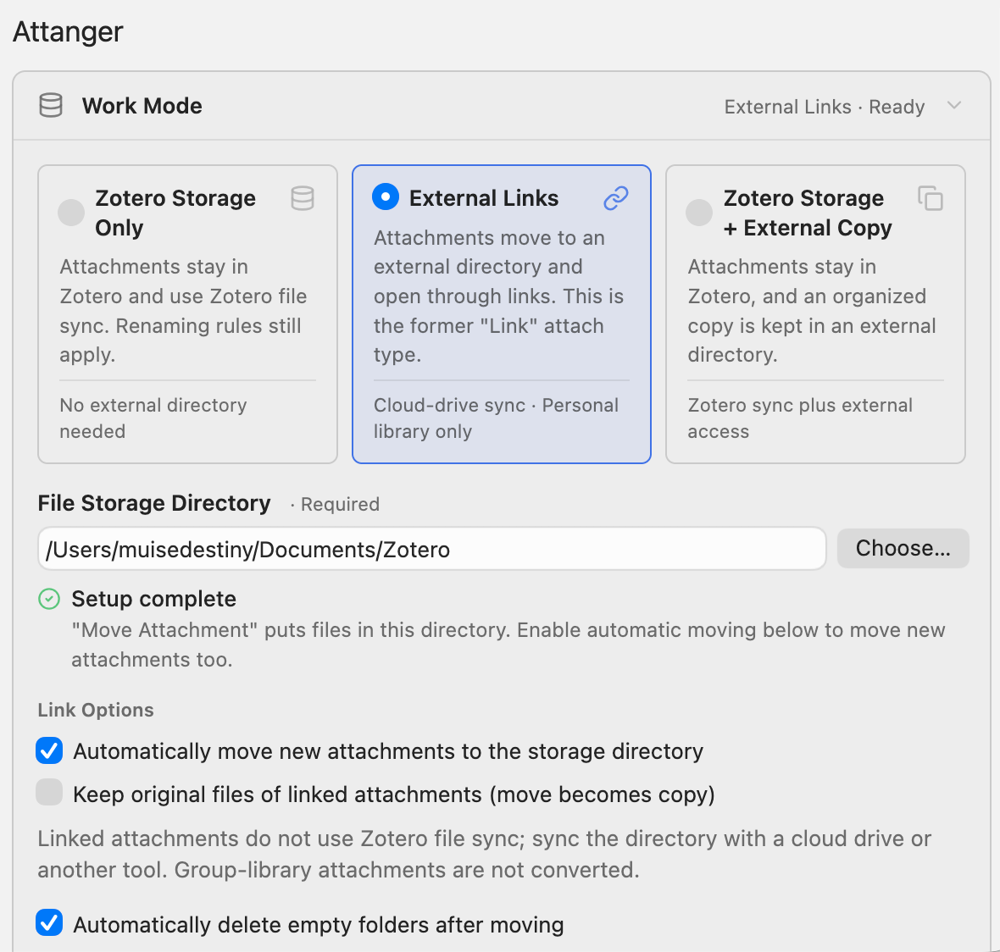
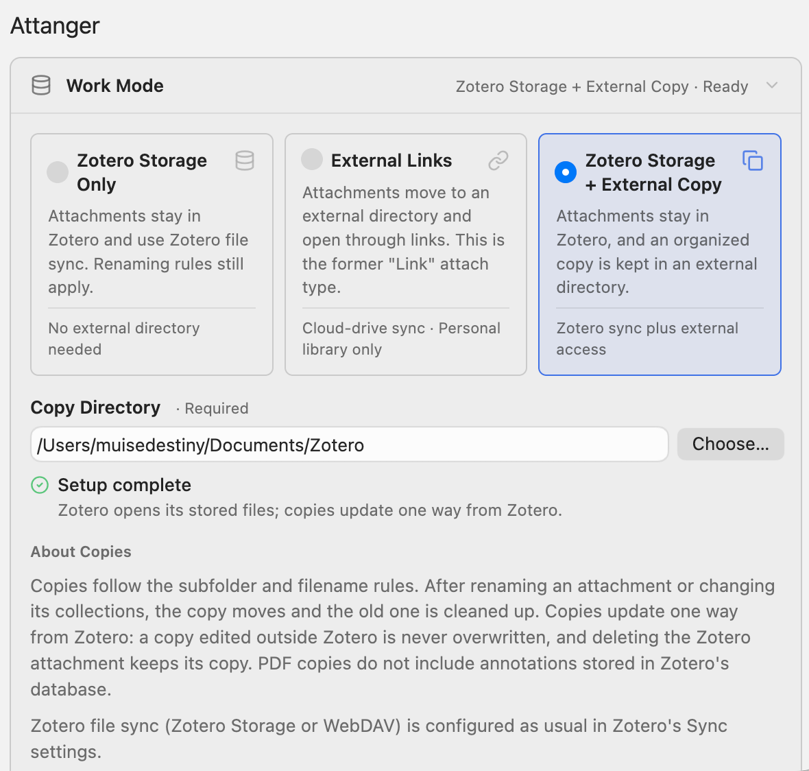
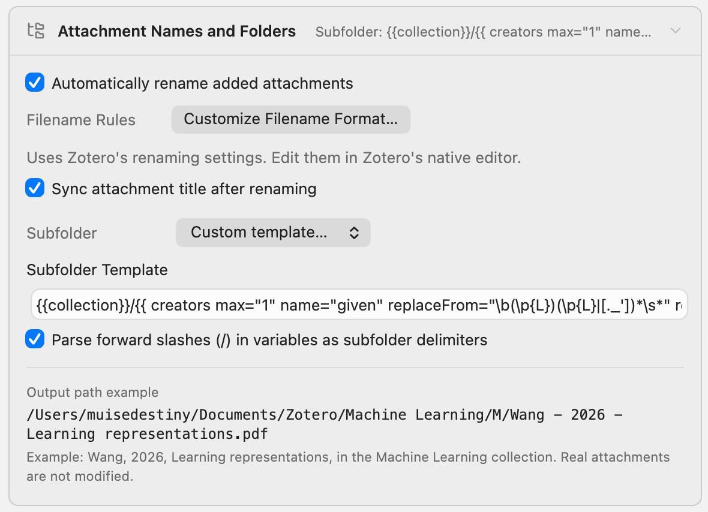
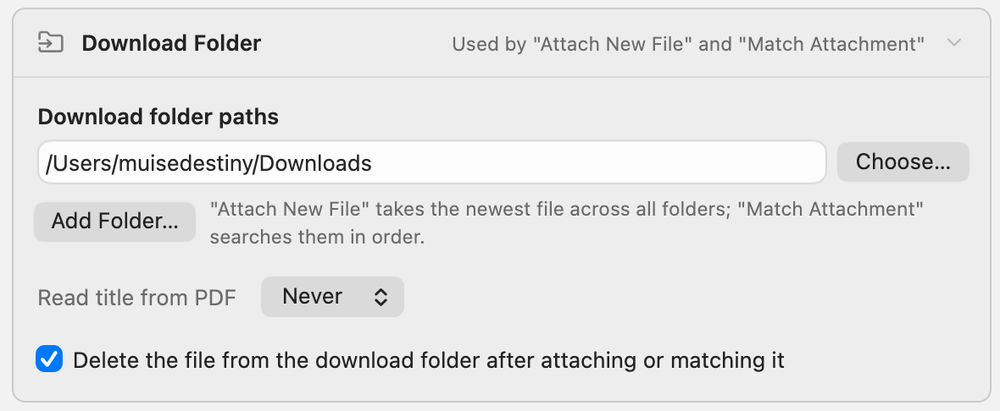
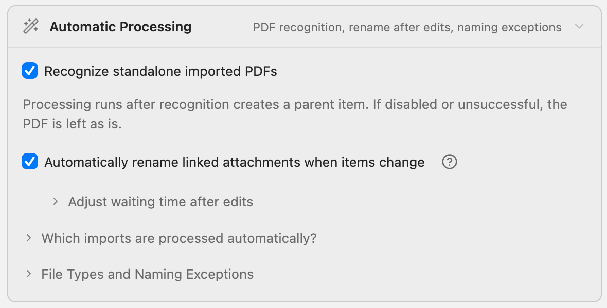

# Zotero Attanger

<p>
  
</p>

Attanger (Attachment Manager) organizza gli allegati di Zotero: allega i
download recenti, abbina i file agli elementi, li rinomina con i modelli
nativi di Zotero e li sposta o copia in una struttura di cartelle prevedibile.

[English](../README.md) | [简体中文](README-zhCN.md) | [Deutsch](README-de.md) | Italiano

[](https://github.com/MuiseDestiny/zotero-attanger/releases)
[](https://github.com/MuiseDestiny/zotero-attanger/releases)
[](https://github.com/MuiseDestiny/zotero-attanger/releases)
[](../LICENSE)
[](https://www.zotero.org/)

## Funzioni principali

- **Tre modalità di lavoro**: mantieni gli allegati nell'archivio di Zotero,
  spostali in una tua cartella come file collegati, oppure tienili in Zotero
  e mantieni una copia ordinata in una cartella esterna.
- **Rinomina nativa**: rinomina gli allegati con il formato dei nomi file di
  Zotero, con sincronizzazione del titolo, rimozione dei segni diacritici ed
  eccezioni tramite espressioni regolari, tutte facoltative.
- **Struttura delle cartelle**: crea sottocartelle da collezioni, anni o
  qualsiasi variabile dei modelli di Zotero; una `/` in un valore può creare
  cartelle annidate.
- **Cartelle dei download**: allega il download più recente a un elemento o
  a una collezione, oppure abbina un gruppo di PDF agli elementi selezionati
  in base al titolo.
- **Elaborazione automatica**: gli allegati aggiunti tramite Attanger,
  trascinamento o Zotero Connector vengono rinominati e organizzati secondo
  la modalità corrente.
- **Rinomina dopo le modifiche**: i nomi dei file collegati restano allineati
  quando cambiano titolo, autori, anno o citation key di Better BibTeX.
- **Gestione sicura dei file**: spostando un allegato archiviato si
  conservano annotazioni, note, tag, relazioni e indice del testo completo; i
  file esistenti non vengono mai sovrascritti.
- **Extra**: apri gli allegati con un'altra applicazione ed esegui i comandi
  principali con scorciatoie configurabili.

## Installazione

1. Scarica l'ultimo `.xpi` dalla
   [pagina delle release](https://github.com/MuiseDestiny/zotero-attanger/releases).
2. In Zotero apri **Strumenti > Plugin** (**Strumenti > Componenti
   aggiuntivi** nelle versioni precedenti).
3. Fai clic sull'ingranaggio, scegli **Installa plugin da file...** e
   seleziona lo `.xpi` scaricato.
4. Riavvia Zotero se richiesto.

Attanger supporta Zotero dalla 7 alla 10.

## Avvio rapido

### Scegliere una modalità di lavoro

|                  | Solo archivio Zotero    | Collegamenti esterni                    | Archivio Zotero + copia esterna |
| ---------------- | ----------------------- | --------------------------------------- | ------------------------------- |
| Zotero apre      | il file archiviato      | il file collegato                       | il file archiviato              |
| Sincronizzazione | Zotero Storage / WebDAV | servizio cloud o altro strumento        | Zotero Storage / WebDAV         |
| Cartella esterna | non necessaria          | obbligatoria; i file si trovano lì      | obbligatoria; contiene le copie |
| Librerie         | tutte                   | solo la libreria personale modificabile | tutte                           |

- **Solo archivio Zotero**: sincronizzi i file con Zotero Storage o WebDAV e
  vuoi solo nomi file coerenti.
- **Collegamenti esterni**: vuoi i file in una tua cartella, sincronizzata da
  OneDrive, Dropbox, Nutstore o un servizio simile.
- **Archivio Zotero + copia esterna**: vuoi mantenere la sincronizzazione
  file di Zotero e consultare anche una cartella ordinata fuori da Zotero.

### Primi passi

1. Apri le **Impostazioni** di Zotero (**Modifica > Impostazioni** su Windows
   e Linux, **Zotero > Impostazioni** su macOS) e seleziona **Attanger**.
2. In **Modalità di lavoro** scegli una modalità. Per le modalità esterne fai
   clic su **Scegli...**, seleziona una cartella e attendi **Configurazione
   completata**.
3. In **Nomi allegati e cartelle** controlla le regole dei nomi file, la
   struttura delle sottocartelle e l'anteprima del percorso.
4. Per usare **Allega nuovo file** o **Abbina allegato**, aggiungi la tua
   cartella dei download in **Cartella dei download**.
5. Prova con alcuni elementi prima di elaborare una selezione ampia.
6. Cambiare modalità non modifica gli allegati esistenti. Per organizzarli,
   seleziona gli elementi, fai clic destro e scegli **Attanger > Sposta
   allegato** o **Attanger > Sincronizza copia esterna**.

## Impostazioni

Le impostazioni sono raggruppate in sezioni comprimibili e ogni intestazione
mostra un breve riepilogo. All'inizio è aperta solo **Modalità di lavoro**;
una ricerca nelle impostazioni di Zotero apre temporaneamente tutte le
sezioni.

Le schermate mostrano l'interfaccia cinese con impostazioni di esempio; i
valori predefiniti sono elencati nel
[riferimento delle impostazioni](#riferimento-delle-impostazioni).

### Modalità di lavoro

<p>
  
</p>

| Modalità                            | Comportamento                                                                                                               | Cartella                      |
| ----------------------------------- | --------------------------------------------------------------------------------------------------------------------------- | ----------------------------- |
| **Solo archivio Zotero**            | Gli allegati restano in Zotero e usano la sincronizzazione file di Zotero. Le regole di rinomina restano attive.            | nessuna                       |
| **Collegamenti esterni**            | Gli allegati vengono spostati in una cartella esterna e aperti tramite collegamento. Corrisponde al vecchio «Collegamento». | **Cartella di archiviazione** |
| **Archivio Zotero + copia esterna** | Gli allegati restano in Zotero e una copia ordinata viene mantenuta in una cartella esterna.                                | **Cartella delle copie**      |

La cartella deve esistere, essere scrivibile e trovarsi fuori dall'archivio
di Zotero, anche se raggiunta tramite un collegamento simbolico. Quando tutto
è pronto, lo stato sotto il campo indica **Configurazione completata**.
Altrimenti indica cosa correggere: **Scegli una cartella esterna per
completare la configurazione** (fino ad allora nulla viene spostato o
copiato), **Cartella non disponibile; sceglila di nuovo**, **Scegli una
cartella esterna all'archivio di Zotero** oppure **Cartella non scrivibile;
scegline un'altra**.

<p>
  
  
</p>

**Opzioni collegamento** (solo Collegamenti esterni):

- **Sposta automaticamente i nuovi allegati nella cartella di archiviazione**
  (attiva per impostazione predefinita): i nuovi allegati archiviati vengono
  rinominati (se la rinomina automatica è attiva), spostati nella cartella e
  convertiti in allegati collegati.
- **Mantieni i file originali degli allegati collegati (lo spostamento
  diventa copia)** (disattivata per impostazione predefinita): quando un
  allegato collegato viene spostato, il vecchio file resta al suo posto e i
  comandi del menu dicono **Copia** invece di **Sposta**. Non si applica agli
  allegati archiviati: vengono sempre convertiti e il loro file archiviato
  viene rimosso insieme al vecchio elemento.
- Zotero non sincronizza i file collegati. Sincronizza la cartella con un
  servizio cloud o un altro strumento. Gli allegati delle librerie di gruppo
  non vengono mai convertiti.

**Informazioni sulle copie** (solo copia esterna):

- Le copie seguono le regole di sottocartella e nome file. Quando rinomini un
  allegato o cambi le sue collezioni, la copia viene spostata e quella
  vecchia rimossa.
- Le copie si aggiornano in un solo verso, da Zotero. Una copia modificata
  fuori da Zotero non viene mai sovrascritta, ed eliminando l'allegato in
  Zotero la copia resta.
- Le copie PDF non contengono le annotazioni fatte in Zotero, perché Zotero
  le conserva nel proprio database.
- La sincronizzazione file di Zotero (Zotero Storage o WebDAV) si configura
  come di consueto nelle impostazioni di sincronizzazione di Zotero.

**Elimina automaticamente le cartelle vuote dopo lo spostamento** (modalità
esterne, disattivata per impostazione predefinita): dopo lo spostamento di un
file, le cartelle rimaste vuote vengono rimosse, ignorando `.DS_Store` e
`Thumbs.db`. Ciò avviene solo sotto la cartella esterna o una cartella dei
download; queste cartelle stesse e l'archivio di Zotero non vengono mai
rimosse.

### Nomi allegati e cartelle

<p>
  
</p>

- **Rinomina automaticamente gli allegati aggiunti**: lo stesso interruttore
  della rinomina automatica di Zotero (`extensions.zotero.autoRenameFiles`),
  quindi influisce anche su Zotero.
- **Regole per i nomi dei file > Personalizza il formato del nome dei
  file...**: apre l'editor nativo di Zotero. Attanger usa questo formato per
  ogni rinomina; vedi la
  [guida di Zotero alla rinomina dei file](https://www.zotero.org/support/file_renaming).
- **Sincronizza il titolo dell'allegato dopo la rinominazione** (disattivata
  per impostazione predefinita): imposta il titolo dell'allegato sul nuovo
  nome file, estensione inclusa. Anche se disattivata, un titolo uguale al
  vecchio nome file o il titolo generico «PDF» viene aggiornato.
- **Sottocartella** (modalità esterne): **Per collezione Zotero**
  (`{{collection}}`, predefinita), **Per anno** (`{{year}}`), **Nessuna
  sottocartella** oppure **Modello personalizzato...**, che mostra **Modello
  di sottocartella** e **Interpretare le barre (/) nelle variabili come
  delimitatori di sottocartelle** (attiva per impostazione predefinita).
- **Esempio di percorso** (**Esempio di nome file** in Solo archivio Zotero):
  un'anteprima dal vivo per un elemento di esempio di Wang, 2026, «Learning
  representations», nella collezione «Machine Learning». Non modifica mai gli
  allegati reali e segnala se il file di esempio `paper-2026.pdf` sarebbe
  escluso dai tipi di file o dalle eccezioni di rinomina.

Come vengono applicati i modelli di sottocartella:

- Separa i livelli di cartella con una `/` tra `}}` e `{{`, per esempio
  `{{collection}}/{{year}}`.
- `{{collection}}` deve essere un livello a sé. Diventa il percorso della
  collezione, come `Machine Learning/Transformers`. I comandi manuali
  preferiscono la collezione selezionata nel riquadro sinistro se l'elemento
  vi appartiene; altrimenti si usa la prima collezione dell'elemento. Gli
  elementi fuori da ogni collezione non ricevono una cartella di collezione.
- Ogni altro livello usa la sintassi dei modelli di nome file di Zotero per
  l'elemento padre, per esempio `{{ year }}` o `{{ creators max="1" }}`. I
  caratteri non ammessi nei nomi delle cartelle vengono rimossi. Una `/` in un
  valore crea una cartella annidata quando l'opzione delle barre è attiva,
  altrimenti viene rimossa.

### Cartella dei download

<p>
  
</p>

Le cartelle dei download sono usate da **Allega nuovo file**, **Abbina
allegato** e **Abbina allegato Attanger**. Le importazioni normali funzionano
anche senza.

- **Percorsi delle cartelle dei download**: **Scegli...** imposta la cartella
  principale, **Aggiungi cartella...** ne aggiunge altre e **Rimuovi** toglie
  una cartella aggiuntiva dall'elenco. Allega nuovo file usa il file più
  recente tra tutte le cartelle. Abbina allegato confronta candidati da tutte
  le cartelle; Abbina allegato Attanger le cerca in ordine.
- **Leggi il titolo dal PDF**: **Mai**, **Tranne per CJK** (predefinito) o
  **Sempre**. Abbina allegato considera sempre i nomi file; questa opzione
  stabilisce se usare anche i titoli dei PDF. **Tranne per CJK** usa solo i
  nomi file per gli elementi con titoli contenenti caratteri cinesi,
  giapponesi o coreani.
- **Elimina il file dalla cartella dei download dopo averlo allegato o
  abbinato** (attiva per impostazione predefinita): rimuove il file sorgente
  dopo che Allega nuovo file o Abbina allegato ha completato l'operazione.
  I file vengono eliminati solo mentre è selezionata **La mia libreria** o
  una sua collezione. I file saltati vengono conservati; Abbina allegato
  Attanger non elimina mai file.

### Elaborazione automatica

<p>
  
</p>

- **Riconosci i PDF importati autonomi** (attiva per impostazione
  predefinita): un PDF importato senza elemento padre passa per il
  riconoscimento dei metadati di Zotero e viene elaborato quando esiste un
  elemento padre. Se l'opzione è disattivata o il riconoscimento fallisce, il
  PDF resta invariato. È indipendente dall'impostazione di Zotero per il
  recupero automatico dei metadati dei PDF.
- **Rinomina automaticamente gli allegati collegati quando l'elemento cambia**
  (disattivata per impostazione predefinita): Zotero rinomina i file quando
  vengono aggiunti, quindi i file collegati esistenti possono mantenere vecchi
  nomi dopo modifiche a titolo, autori, anno o citation key di Better BibTeX.
  Questa opzione li rinomina di nuovo. Riguarda i file collegati esistenti e
  modificabili dei tipi configurati e rispetta la regola «non spostati,
  copiati o rinominati automaticamente».
- **Regola il tempo di attesa dopo le modifiche** (visibile mentre l'opzione
  precedente è attiva):
  - **Debounce rinomina dopo modifica (ms)** (attivo, 1000): una modifica può
    generare più notifiche, quindi Attanger attende che le modifiche si
    fermino. Usa normalmente 1000 ms, 1500-3000 ms se le rinomine si
    ripetono, oppure 300-500 ms per una risposta più rapida.
  - **Ritardo rinomina dopo modifica (ms)** (disattivo, 0): attesa aggiuntiva
    dopo il debounce per valori aggiornati in modo asincrono, come le chiavi
    di Better BibTeX. Inizia con 300-1000 ms e usa 1500-3000 ms se compaiono
    ancora valori vecchi.
- **Quali importazioni vengono elaborate automaticamente?** I nuovi allegati
  da Attanger, trascinamento o Zotero Connector seguono la modalità corrente.
  I file collegati aggiunti direttamente non vengono convertiti. I PDF
  autonomi vengono elaborati solo dopo che il riconoscimento crea un elemento
  padre.

**Tipi di file ed eccezioni di rinomina**:

- **Tipi di allegati da rinominare/spostare** (predefinito
  `pdf,doc,docx,txt,rtf,djvu,epub`): estensioni separate da virgole, senza
  distinzione tra maiuscole e minuscole, con o senza punto iniziale; gli
  spazi dopo le virgole vengono ignorati. Lascia vuoto per includere tutti i
  tipi. Gli altri file non vengono rinominati, spostati o copiati.
- **Rimuovi i segni diacritici dai nomi dei file** (disattivata per
  impostazione predefinita): converte lettere accentate e legature nel nome
  file finale in lettere semplici, per esempio `Müller` in `Muller`.
  L'estensione resta invariata.
- Tre elenchi di espressioni regolari separate da virgole, per esempio
  `SI\d+, .+_si`. Vengono confrontate con il nome file corrente senza
  estensione e non sono ancorate, quindi `SI\d+` corrisponde anche a `CASI2`.

| Se il nome file corrisponde...                                   | Risultato                                                                                                       |
| ---------------------------------------------------------------- | --------------------------------------------------------------------------------------------------------------- |
| «...il nome file originale verrà mantenuto come prefisso»        | Il vecchio nome resta davanti: `SI1.pdf` diventa `SI1_Wang - 2026 - Learning representations.pdf`.              |
| «...gli allegati non verranno rinominati»                        | Nessuna rinomina, né manuale né automatica.                                                                     |
| «...non verranno spostati, copiati o rinominati automaticamente» | Saltato dall'elaborazione automatica e dalla rinomina dopo le modifiche; i comandi manuali funzionano comunque. |

Poiché le virgole separano le regole, una regola non può contenere una
virgola, quindi un quantificatore come `{2,3}` non è possibile. Le
espressioni non valide vengono ignorate e scritte nel log di debug.

### Scorciatoie da tastiera

| Comando                                | Predefinita        | Attiva per impostazione predefinita |
| -------------------------------------- | ------------------ | ----------------------------------- |
| Allega nuovo file                      | `Ctrl + I`         | sì                                  |
| Abbina allegato                        | `Ctrl + M`         | sì                                  |
| Rinomina allegato                      | `Ctrl + R`         | no                                  |
| Rinomina e sposta/sincronizza allegato | `Ctrl + Shift + R` | no                                  |
| Sposta/sincronizza allegato            | `Ctrl + Shift + M` | no                                  |

Spunta un comando per attivarne la scorciatoia, fai clic nel campo e premi la
combinazione di tasti. Le modifiche valgono subito e le scorciatoie attive
compaiono accanto ai comandi del menu. `Ctrl` indica il tasto Control su
tutte le piattaforme, macOS compreso; una combinazione registrata con Cmd
viene salvata come `Meta`. Le scorciatoie Sposta/sincronizza seguono la
modalità di lavoro; in Solo archivio Zotero, **Sposta/sincronizza allegato**
mostra solo un avviso.

La sezione **Info** rimanda al progetto su GitHub, al canale Bilibili
dell'autore e ad altri plugin.

### Riferimento delle impostazioni

Le preferenze si trovano sotto `extensions.zotero.zoteroattanger.` e si
possono consultare anche in **Impostazioni > Avanzate > Editor di
configurazione**.

| Impostazione                                  | Preferenza                                                                            | Predefinito                                                   |
| --------------------------------------------- | ------------------------------------------------------------------------------------- | ------------------------------------------------------------- |
| Modalità di lavoro                            | `workMode`                                                                            | `stored` su nuova installazione (`stored`, `linked` o `copy`) |
| Cartella di archiviazione / delle copie       | `destDir`                                                                             | vuoto                                                         |
| Sposta automaticamente i nuovi allegati       | `autoMove`                                                                            | `true`                                                        |
| Mantieni i file originali                     | `moveWithoutDeleting`                                                                 | `false`                                                       |
| Elimina automaticamente le cartelle vuote     | `autoRemoveEmptyFolder`                                                               | `false`                                                       |
| Rinomina automaticamente gli allegati         | `extensions.zotero.autoRenameFiles` (Zotero)                                          | `true`                                                        |
| Sincronizza il titolo dell'allegato           | `syncAttachmentTitle`                                                                 | `false`                                                       |
| Modello di sottocartella                      | `subfolderFormat`                                                                     | `{{collection}}`                                              |
| Barre come delimitatori                       | `slashAsSubfolderDelimiter`                                                           | `true`                                                        |
| Cartella dei download                         | `sourceDir`                                                                           | vuoto                                                         |
| Cartelle dei download aggiuntive              | `extraSourceDirs`                                                                     | `[]` (array JSON)                                             |
| Leggi il titolo dal PDF                       | `readPDFtitle`                                                                        | `nonCJK` (`never`, `nonCJK` o `always`)                       |
| Elimina il file dalla cartella dei download   | `deleteSourceAfterImport`                                                             | `true`                                                        |
| Riconosci i PDF importati autonomi            | `autoRecognizeImportedPDF`                                                            | `true`                                                        |
| Rinomina i collegati quando l'elemento cambia | `autoRenameOnModify`                                                                  | `false`                                                       |
| Debounce                                      | `autoRenameOnModifyDebounceEnabled`, `autoRenameOnModifyDebounceMs`                   | `true`, `1000`                                                |
| Ritardo                                       | `autoRenameOnModifyDelayEnabled`, `autoRenameOnModifyDelayMs`                         | `false`, `0`                                                  |
| Tipi di allegati                              | `fileTypes`                                                                           | `pdf,doc,docx,txt,rtf,djvu,epub`                              |
| Rimuovi i segni diacritici                    | `removeDiacritics`                                                                    | `false`                                                       |
| Eccezioni di rinomina                         | `filenameAsPrefixRules`, `filenameSkipRenameRules`, `filenameSkipAutoMoveRenameRules` | vuoto                                                         |
| Scorciatoie                                   | `<command>.shortcut`, `<command>.shortcut.enable`                                     | vedi [Scorciatoie da tastiera](#scorciatoie-da-tastiera)      |
| App di Apri con                               | `openUsing`                                                                           | elenco vuoto                                                  |

`<command>` è `attachNewFile`, `matchAttachment`, `renameAttachment`,
`renameMoveAttachment` o `moveAttachment`. La vecchia preferenza `attachType`
segue la modalità di lavoro (`linking` per Collegamenti esterni, altrimenti
`importing`), così le versioni precedenti di Attanger funzionano ancora dopo
un downgrade.

## Comandi del menu

Fai clic destro sugli elementi selezionati e apri **Attanger**. Tre voci
dipendono dalla modalità di lavoro:

| Voce                       | Solo archivio Zotero                | Collegamenti esterni                | Archivio Zotero + copia esterna          |
| -------------------------- | ----------------------------------- | ----------------------------------- | ---------------------------------------- |
| Rinomina e sposta/sincron. | **Rinomina allegato**               | **Rinomina e sposta allegato**      | **Rinomina e sincronizza copia esterna** |
| Sposta/sincronizza         | nascosta                            | **Sposta allegato**                 | **Sincronizza copia esterna**            |
| Annulla                    | **Annulla lo spostamento allegato** | **Annulla lo spostamento allegato** | **Annulla lo spostamento allegato**      |

Con **Mantieni i file originali degli allegati collegati** attiva,
Collegamenti esterni mostra invece **Rinomina e copia allegato**, **Copia
allegato** e **Annulla la copia allegato**.

- **Allega nuovo file** (esattamente un elemento normale selezionato): allega
  il file più recente delle cartelle dei download. È accettato qualsiasi tipo
  di file; file nascosti e sottocartelle vengono ignorati. Se non esiste una
  cartella dei download, Attanger chiede di sceglierne una.
- **Rinomina e sposta allegato**: sposta ogni allegato e poi lo rinomina; se
  lo spostamento viene saltato, non viene rinominato nulla. **Rinomina e
  sincronizza copia esterna** rinomina e poi sincronizza la copia.
- **Abbina allegato**: assegna i file PDF e CAJ delle cartelle dei download
  agli elementi selezionati per somiglianza del titolo. Vedi
  [Abbinare i file scaricati](#abbinare-i-file-scaricati).
- **Abbina allegato Attanger**: trova i file che hanno già il percorso e il
  nome previsti da Attanger. Vedi
  [Ricollegare una libreria esistente](#ricollegare-una-libreria-esistente).
- **Rinomina allegato**: rinomina gli allegati figli della selezione con il
  formato dei nomi file di Zotero. Gli allegati autonomi vengono saltati.
- **Sposta allegato** / **Sincronizza copia esterna**: sposta i file nella
  cartella di archiviazione oppure crea e aggiorna le loro copie esterne. Gli
  allegati autonomi sono inclusi.
- **Annulla lo spostamento allegato**: esegue **Converti in file archiviati**
  di Zotero sugli allegati collegati selezionati e su quelli degli elementi
  selezionati. Zotero chiede se eliminare i file originali dopo
  l'archiviazione. Gli allegati ripristinati restano nell'archivio di Zotero,
  anche con lo spostamento automatico attivo.

Altri due comandi si trovano fuori dal sottomenu Attanger:

- **Apri con** (menu dell'elemento, quando la selezione contiene allegati):
  apre il file con **Zotero**, **Sistema** (l'app predefinita), un'app
  memorizzata oppure **Scegli altra app**. Fai clic destro su un'app
  memorizzata per rimuoverla. Per un elemento normale viene aperto l'allegato
  migliore. Funziona cambiando il gestore PDF di Zotero, quindi è pensato per
  i PDF.
- **Allega nuovo file** (menu della collezione): aggiunge il download più
  recente alla collezione come allegato autonomo e avvia il riconoscimento
  dei metadati.

## Flussi di lavoro comuni

### Allegare l'ultimo download

1. Salva il PDF in una cartella dei download.
2. Seleziona il suo elemento e premi `Ctrl + I` (oppure scegli **Attanger >
   Allega nuovo file**).
3. Il file viene allegato, poi rinominato e spostato o copiato secondo la
   modalità corrente. Il file scaricato viene eliminato se l'opzione è attiva.

Per creare invece un nuovo elemento dal PDF, fai clic destro su una
collezione e scegli **Allega nuovo file**.

Se l'elemento ha già un allegato archiviato o collegato con lo stesso
contenuto PDF, Attanger salta il file e conserva il download. Entrambi
i comandi di abbinamento usano lo stesso controllo del contenuto, indipendente
dal nome file o dal titolo dell'allegato. I duplicati già presenti nella
libreria non vengono rimossi.

### Abbinare i file scaricati

1. Metti i PDF in una cartella dei download.
2. Seleziona solo gli elementi i cui file si trovano lì e premi `Ctrl + M`.
3. Attanger confronta tutti i candidati e assegna prima gli abbinamenti più
   affidabili. Ogni file viene usato al massimo una volta; i titoli brevi non
   hanno più la precedenza.

> Gli abbinamenti poco simili o ambigui vengono saltati e i file sorgente
> conservati. Questo vale, per esempio, quando più PDF sono candidati quasi
> equivalenti per un elemento, oppure un file non è distinguibile con
> sufficiente affidabilità tra più elementi selezionati.

Vengono considerati solo i file `.pdf` e `.caj` direttamente nelle cartelle
dei download. Il punteggio combina i nomi file con i titoli candidati
disponibili nel PDF, quando **Leggi il titolo dal PDF** lo consente:
**Mai** usa solo i nomi file, **Sempre** usa nomi file e titoli del PDF,
mentre **Tranne per CJK** usa solo i nomi file per i titoli contenenti
caratteri cinesi, giapponesi o coreani. Punteggiatura, legature e segni
diacritici vengono normalizzati per il confronto, mantenendo numeri
significativi e negazioni.

Quando la lettura dei PDF e consentita, il DOI esatto dell'articolo ha
priorita. Il DOI dell'articolo nei metadati dell'editore prevale sui DOI
delle citazioni consigliate stampate nella pagina; DOI in conflitto o
ambigui non vengono abbinati automaticamente.

I titoli candidati del PDF provengono dai metadati e da righe consecutive in
caratteri grandi sulla prima pagina di testo utilizzabile, non da
intestazioni grandi come «Appendix» nelle pagine successive. Se la lettura
fallisce o supera 30 secondi, resta possibile usare il nome file.

I PDF duplicati vengono verificati in base al contenuto effettivo (MD5 e
dimensione del file), confrontandoli con i PDF archiviati e collegati dello
stesso elemento. Nomi o titoli uguali non bastano; contenuti diversi non
vengono saltati come duplicati. Le copie scaricate con contenuto identico,
anche con `(1)` nel nome file, vengono considerate una sola volta per
operazione. Le altre copie e i file saltati come duplicati restano nella
cartella dei download. Per i file allegati con successo continua a valere
l'opzione di eliminazione del file sorgente.

Se la lettura del PDF è consentita, vengono riconosciute anche copie
ricodificate con hash diversi: servono lo stesso DOI univoco, lo stesso
numero di pagine, testo e impaginazione iniziali identici, testo completo
identico pagina per pagina, dimensioni quasi uguali e hash di rendering
identici per tutte le pagine complete, comprese le figure. DOI o titolo
da soli non bastano. Il controllo conservativo è limitato a PDF testuali
fino a 64 MiB e 100 pagine, a 144 dpi e al massimo 16 megapixel per pagina.
Se il renderer non è disponibile o la verifica fallisce o scade, i file
non vengono ignorati come duplicati ricodificati.

### Ricollegare una libreria esistente

Utile quando i file sono già organizzati secondo la struttura di Attanger,
per esempio dopo aver reinstallato Zotero o su un nuovo computer.

1. Verifica che il modello di sottocartella e il formato dei nomi file di
   Zotero producano ancora i percorsi esistenti.
2. Aggiungi la radice di quella cartella come cartella dei download.
3. Seleziona gli elementi e scegli **Attanger > Abbina allegato Attanger**.

Per ogni estensione in **Tipi di allegati da rinominare/spostare**, Attanger
cerca `<cartella dei download>/<sottocartella>/<nome file>.<estensione>`,
provando le cartelle in ordine. I PDF vengono saltati come duplicati se
l'elemento ha già un PDF archiviato o collegato con lo stesso contenuto, non
soltanto con lo stesso nome file o titolo. I file sorgente non vengono mai
eliminati.

- In **Solo archivio Zotero** e **Collegamenti esterni**, i file vengono
  aggiunti come allegati collegati dove si trovano. Funziona solo in La mia
  libreria.
- In **Archivio Zotero + copia esterna**, i file vengono importati
  nell'archivio di Zotero. Se la cartella dei download è la cartella delle
  copie stessa, il file originale viene adottato come copia esterna e non si
  crea un duplicato `name_1.ext`.

### Organizzare gli allegati esistenti dopo un cambio di modalità

- **Verso Collegamenti esterni**: seleziona gli elementi ed esegui **Sposta
  allegato**. Gli allegati archiviati diventano file collegati nella cartella
  di archiviazione e conservano annotazioni, note, tag, relazioni e indice
  del testo completo.
- **Verso la copia esterna**: seleziona gli elementi ed esegui una volta
  **Sincronizza copia esterna**. In seguito le copie si aggiornano
  automaticamente.
- **Di nuovo nell'archivio di Zotero**: seleziona gli elementi ed esegui
  **Annulla lo spostamento allegato**. Gli allegati diventano file archiviati
  e lo spostamento automatico non li sposta di nuovo. Passa anche a **Solo
  archivio Zotero** se vuoi che anche i nuovi allegati restino in Zotero.

### Rinominare dopo gli aggiornamenti di Better BibTeX

Se il formato dei nomi file usa la citation key di Better BibTeX, la chiave
potrebbe non essere ancora pronta quando il file viene aggiunto.

1. Attiva **Rinomina automaticamente gli allegati collegati quando l'elemento
   cambia**.
2. Lascia il debounce a 1000 ms. Se i file ricevono ancora la vecchia
   chiave, attiva il ritardo e inizia con 300-1000 ms.

Questo rinomina solo i file collegati. Per gli allegati archiviati esegui
**Rinomina allegato** dopo il cambio della chiave.

## Come funziona l'elaborazione automatica

I nuovi allegati vengono raccolti per circa un secondo e poi elaborati uno
alla volta:

1. Gli allegati collegati appena creati da Attanger stesso e quelli
   ripristinati da **Annulla lo spostamento allegato** vengono saltati.
2. Un PDF importato autonomo viene prima riconosciuto se **Riconosci i PDF
   importati autonomi** è attiva. Senza elemento padre l'elaborazione si
   ferma.
3. I tipi di file non supportati e i file che corrispondono alla regola «non
   spostati, copiati o rinominati automaticamente» restano invariati.
4. Se **Rinomina automaticamente gli allegati aggiunti** è attiva, il file
   viene rinominato. Ciò include i file collegati aggiunti direttamente, che
   vengono rinominati sul posto.
5. In **Collegamenti esterni** con spostamento automatico, gli allegati
   archiviati vengono prima rinominati, poi spostati e convertiti in allegati
   collegati.
6. In **Archivio Zotero + copia esterna**, gli allegati archiviati vengono
   rinominati e poi copiati nella cartella delle copie.

Spostare un elemento nel cestino o eliminarlo annulla la sua elaborazione in
sospeso. Tutte le operazioni sui file passano per un'unica coda.

**Spostamento (Collegamenti esterni)**

- Richiede una libreria personale modificabile; altrimenti Attanger segnala
  «I collegamenti esterni funzionano solo in una libreria personale
  modificabile.»
- La destinazione è `<cartella di archiviazione>/<sottocartella>/<nome
file>`. Il file viene copiato in un file temporaneo, verificato con MD5 e
  pubblicato senza sovrascrivere nulla: i nomi occupati ricevono `_1`, `_2` e
  così via. Un file che è già nella sua destinazione resta dov'è.
- Un allegato collegato viene ricollegato. Il suo vecchio file viene
  eliminato, a meno che **Mantieni i file originali degli allegati collegati**
  sia attiva, un altro allegato lo usi, sia cambiato durante lo spostamento o
  si trovi nell'archivio di Zotero.
- Un allegato archiviato viene sostituito da un nuovo allegato collegato.
  Annotazioni (anche quelle nel cestino), note figlie, tag, relazioni, la nota
  dell'allegato e l'indice del testo completo vengono trasferiti; poi
  l'elemento archiviato e il suo file vengono eliminati.

**Rinomina**

- Richiede un elemento padre. Il nuovo nome è il formato dei nomi file di
  Zotero più l'estensione originale.
- Le regole si applicano in quest'ordine: regola di esclusione, regola del
  prefisso, rimozione dei segni diacritici.
- Se il nome è occupato si usa la numerazione di Zotero (`name 2.pdf`).
- Un file collegato condiviso da più allegati viene copiato con il nuovo nome
  e ricollegato, così gli altri allegati mantengono il loro file.
- Le rinomine non riuscite, per esempio di un file bloccato, vengono
  riprovate fino a cinque volte a tre secondi di distanza.

**Copie esterne**

- Solo gli allegati archiviati ricevono copie; gli allegati collegati vengono
  saltati con un avviso.
- Una copia viene aggiornata circa un secondo dopo una modifica di allegato,
  file o collezioni. Vale solo per gli allegati che hanno già una copia,
  quindi esegui una volta **Sincronizza copia esterna** per gli allegati
  esistenti.
- Una copia mancante viene ricreata. Una copia modificata fuori da Zotero, o
  a cui un altro allegato è collegato, viene segnalata come conflitto e
  lasciata intatta. Altrimenti la copia viene sostituita in modo atomico, con
  backup e ripristino.
- Quando il percorso di destinazione cambia, viene scritta una nuova copia e
  quella vecchia viene rimossa solo se invariata e inutilizzata. Se nella
  destinazione c'è già un file con contenuto identico non usato da alcun
  allegato, viene adottato come copia; un file diverso viene mantenuto e la
  copia riceve `name_1.ext`.
- I record delle copie si trovano in `attanger-external-copies.json` nella
  cartella dati di Zotero.

## Aggiornamento da versioni precedenti

Al primo avvio Attanger converte una sola volta le vecchie impostazioni:

- Il vecchio **Tipo di allegato: Collegamento** con un percorso di
  destinazione diventa **Collegamenti esterni**; tutto il resto diventa
  **Solo archivio Zotero**. **Archivio Zotero + copia esterna** è nuova,
  quindi sceglila tu se ti serve.
- **Elimina il file dalla cartella dei download dopo averlo allegato o
  abbinato** viene impostata all'opposto della vecchia opzione **Mantieni i
  file originali**, così le cartelle dei download si comportano come prima.
- In Collegamenti esterni, lo spostamento automatico e **Mantieni i file
  originali** mantengono il significato precedente.
- Scorciatoie e allegati esistenti non vengono modificati.

## Note e limitazioni

- Zotero non sincronizza i file collegati. Sincronizza tu la cartella di
  archiviazione e valuta di impostarla in **Impostazioni > Avanzate > File e
  cartelle** come cartella base degli allegati collegati, così i collegamenti
  funzionano anche su altri computer.
- Collegamenti esterni funziona solo nella tua libreria personale
  modificabile; gli allegati delle librerie di gruppo non vengono mai
  spostati. Fuori dalla modalità copia esterna, **Abbina allegato Attanger**
  crea allegati collegati, quindi richiede anch'esso La mia libreria.
- I file esistenti non vengono mai sovrascritti: spostamenti e copie
  aggiungono `_1`, `_2` e così via, mentre le rinomine usano la numerazione di
  Zotero (`name 2.pdf`). La copia esterna riutilizza un file nella
  destinazione solo se il contenuto è identico.
- I file delle cartelle dei download vengono eliminati solo mentre è
  selezionata **La mia libreria** o una sua collezione.
- Le copie PDF esterne non contengono le annotazioni di Zotero; usa
  l'esportazione PDF di Zotero se ti servono nel file.
- Una regola di eccezione non può contenere virgole.
- `Ctrl` nelle scorciatoie indica il tasto Control anche su macOS.
- **Abbina allegato** salta i PDF poco affidabili, ambigui o duplicati e
  conserva i file sorgente; non elimina gli allegati duplicati già presenti.
- I file collegati aggiunti direttamente possono essere rinominati sul posto
  ma non vengono mai spostati.
- Le versioni recenti di Zotero possono rinominare i file da sole quando
  cambiano i metadati, anche i file collegati se abilitato nelle impostazioni
  di rinomina di Zotero. Usa quella funzione oppure **Rinomina
  automaticamente gli allegati collegati quando l'elemento cambia** di
  Attanger, non entrambe.

## Schermate e guide

<p>
  
</p>

Il menu dell'elemento in modalità Collegamenti esterni (interfaccia cinese).

- [Dimostrazione video (cinese)](https://www.bilibili.com/video/BV1x64y1J7Rv)
- [Guida della comunità (francese)](https://docs.zotero-fr.org/kbfr/kbfr_attanger_zotmoov/)

## Contribuire

Segnalazioni, correzioni, nuove funzioni, test, documentazione e traduzioni
sono benvenuti. Pull request piccole e mirate sono più semplici da verificare
e pubblicare in sicurezza.

Una segnalazione dovrebbe includere versioni di Zotero e Attanger, sistema
operativo, modalità di lavoro, impostazioni rilevanti, passaggi esatti e
output di debug (**Aiuto > Registrazione output di debug**). Rimuovi dati
bibliografici privati e percorsi locali dai log.

Sviluppo locale:

```bash
git clone https://github.com/MuiseDestiny/zotero-attanger.git
cd zotero-attanger
npm install
cp scripts/zotero-cmd-template.json scripts/zotero-cmd.json
# Imposta zoteroBinPath e profilePath; usa un profilo Zotero di test separato
npm start
```

`npm start` avvia Zotero con il plugin e lo ricarica quando cambiano i file in
`src/` o `addon/`.

Prima di aprire una pull request:

```bash
npm run build:local              # controllo dei tipi, poi build/zotero-attanger.xpi
npm test
npx eslint src/modules/menu.ts   # controlla i file modificati
```

`npm run lint` formatta e corregge l'intero repository, quindi è preferibile
eseguire ESLint solo sui file modificati per mantenere il diff mirato.

### I contributi assistiti dall'IA sono benvenuti

È possibile usare strumenti di IA per implementazione, debug, test,
documentazione o traduzione. L'uso dell'IA non è un motivo di rifiuto, ma chi
invia il contributo resta responsabile del risultato:

- Rivedere e comprendere le modifiche generate prima dell'invio.
- Provare realmente i flussi interessati e indicare cosa è stato verificato.
- Mantenere la modifica mirata, senza riscritture generate non pertinenti.
- Non inviare a servizi IA librerie private, log, credenziali o documenti
  protetti senza autorizzazione.
- Verificare licenze e regole sulle dipendenze anche per codice e risorse
  generati.
- Dichiarare brevemente l'assistenza IA rilevante nella pull request quando
  aiuta i revisori a capire produzione o verifica della modifica.

Le traduzioni dell'interfaccia sono in `addon/locale/`, quelle della
documentazione in `doc/`. Chiavi e descrizioni devono restare allineate.

## Licenza e crediti

Zotero Attanger è distribuito con licenza
[AGPL-3.0-or-later](../LICENSE). Il flusso di gestione degli allegati è
fortemente ispirato a ZotFile. Il progetto usa
[Zotero Plugin Template](https://github.com/windingwind/zotero-plugin-template)
e [zotero-plugin-toolkit](https://github.com/windingwind/zotero-plugin-toolkit).
